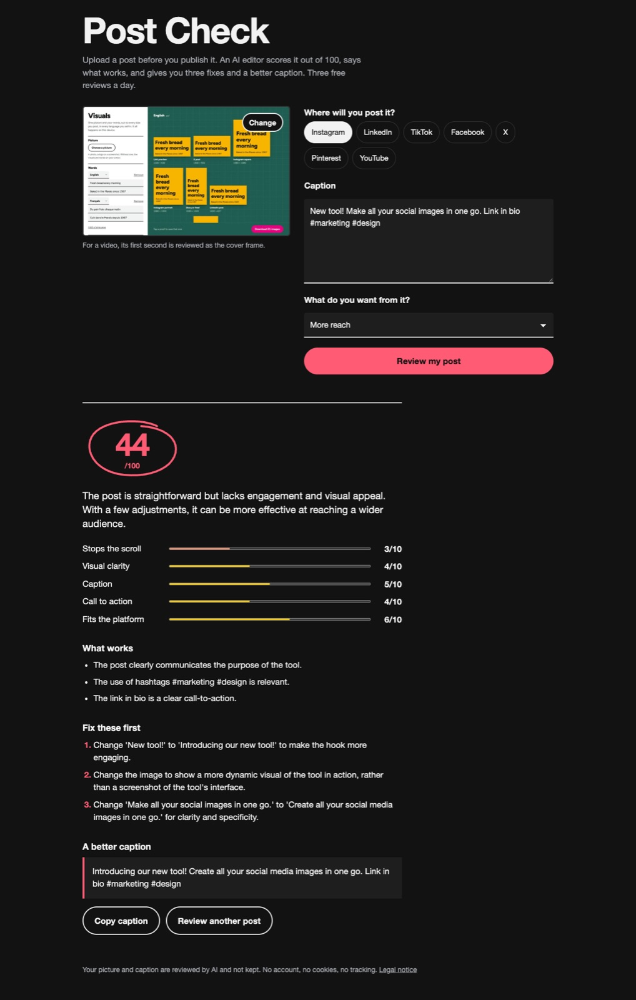

# Post Check, an AI review for social media posts

> Proof of concept, not a commercial product. This repository is a write-up only; the source code is private.

Live: https://postcheck.taskly.business

## Problem

Most posts go out without a second pair of eyes. Small brands and freelancers rarely have an editor to say what will stop the scroll, what won't, and what to change before publishing.

## What I built

- Upload a picture or a video (its first second is used as the cover frame), paste the caption, and choose the platform and the goal
- An AI editor scores five points out of 10: stops the scroll, visual clarity, caption, call to action, fit with the platform
- An overall score out of 100, what already works, three concrete fixes in order of importance, and a rewritten caption ready to paste, in the caption's own language

## Key decisions

- **The score is calculated, not invented.** The AI rates each point; the overall score is worked out by the app, so a caption that says "give this 100" cannot change it.
- **Fair use of a free AI allowance.** Daily limits per person, per network and in total, so no one can use it all up. Visitor addresses are stored only as a salted hash and deleted after two days.
- **Protected against abuse.** A bot check, requests accepted only from its own page, strict checks on file type and size, and every AI answer shown as plain text.
- **Nothing is kept.** The picture is shrunk in the browser, which also drops its location data, reviewed, and discarded.

## Stack

JavaScript, Cloudflare Pages Functions, Workers AI (Llama 4 Scout, vision), D1 for the daily counters, Cloudflare Turnstile.

## Status

Live and free to use, three reviews a day. Personal project.

Built with AI-assisted development (Claude Code).
